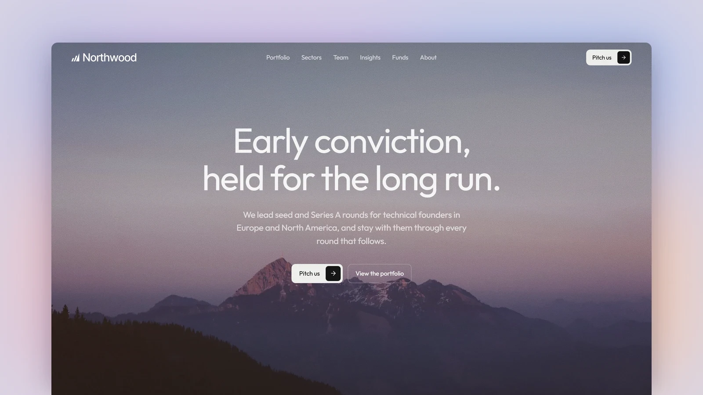

# Northwood - Astro Venture Capital Theme

[](https://northwood.xocoweb.workers.dev/)

[](https://astro.build/)
[](https://tailwindcss.com/)
[](https://www.typescriptlang.org/)
[](./LICENSE)

**Live preview:** https://northwood.xocoweb.workers.dev/

Northwood is a premium Astro theme for venture capital and investment firms. It is built on three linked content collections (portfolio companies, the team, and an insights journal), so the directory, profiles, and fund statistics all come from the content rather than being typed twice. A single geometric sans, a light grey palette with grainy charcoal panels and soft warm-to-cool glows, and a full-width dusk photograph give it a calm, high-end feel, and the output is fully static.

## Features

- A portfolio directory filterable by sector, stage of first investment, and status, with text search, grid and list views, and filters kept in the URL so any view can be linked to
- A page for every company with its logo, status, facts, founders, lead partner, a funding-history timeline, related insights, and more companies from the same sector
- A page per sector with its thesis, themes, figures counted from the portfolio, companies, and the partners who cover it
- Partner and team profiles grouped by role, each listing the companies the person leads and the pieces they have written
- An insights journal with essays, investor letters, playbooks, and news, category archives, and pagination
- Investor letters set as letters, with a sign-off built from the authors and a cover card showing the period
- Fund statistics: firm totals, a fund table with TVPI, DPI, and net IRR, and a disclosure note, all from one config file
- Portfolio breakdowns by sector, stage, and status, and a list of realised exits, counted from the companies themselves
- A pitch form for founders with criteria, next steps, and a FAQ, provider-neutral and disabled until an endpoint is set
- Privacy, terms, and regulatory disclosure pages in Markdown
- Collections that reference each other, validated at build time, so a mistyped partner, company, or fund fails the build
- A full-width photographic hero with film grain and a centred headline, and grainy dark panels lit by a warm-to-cool glow
- An about page whose timeline adds every fund close and exit to the milestones you write
- Company logos read from an SVG beside each company and drawn in the text colour, with the name as a fallback
- A centred reading column, a reading-progress line, a share sheet, and a keyboard search palette (`/` or `⌘K`) for the journal
- Canonical URLs, sitemap, RSS, Open Graph, Twitter/X cards, and JSON-LD for articles, people, and companies
- Buttons that carry their arrow in a small square box, a neutral palette with colour kept for accents, and rounded media
- Static output with no framework islands; every animation settles under `prefers-reduced-motion`
- Skip link, landmarks, labelled controls, visible focus states, and keyboard support for every menu, filter, and dialog

## Tech Stack

- Astro 7 with MDX
- Tailwind CSS 4 via the Vite plugin
- Vite 8, TypeScript, Astro content collections with references
- `@astrojs/sitemap`, `@astrojs/rss`, Sharp
- Self-hosted Outfit, Lucide and Bootstrap Icons, each with its license notice

## Requirements

- Node.js `22.12.0` or newer
- npm

## Getting Started

```bash
npm install
npm run dev
```

Build for production:

```bash
npm run build
```

Preview the production build locally:

```bash
npm run preview
```

Before shipping a change, run type checking, the production build, and the formatter check together:

```bash
npm run release:check
```

## Customization

See [CUSTOMIZATION.md](./CUSTOMIZATION.md) for site settings, navigation, the three collections and their fields, company logos, sectors and stages, funds and their statistics, the pitch, contact, and newsletter forms, the homepage and about page, search, sharing, feeds, and the theme's design tokens.

Set `siteConfig.siteUrl` in [src/config/site.ts](./src/config/site.ts) before building — canonical URLs, share images, the sitemap, and the feed are all derived from it. The build is static, so any host that serves a directory works: `wrangler.jsonc` is included for Cloudflare Workers, and Netlify, Vercel, GitHub Pages, and object storage behind a CDN need no configuration beyond `npm run build`.

## Content

Portfolio companies live in [src/content/companies](./src/content/companies), the team in [src/content/team](./src/content/team), and the journal in [src/content/insights](./src/content/insights). Each entry is a folder with an `index.md` and the images or logo it uses, validated by the schemas in [src/content.config.ts](./src/content.config.ts). Funds, sectors, and page copy are in [src/config](./src/config).

The bundled demo content is fictional — the firm, its partners, the companies, their founders and acquirers, the letters, and every fund figure are invented, so **replace them before launch.** The portraits are stock placeholders of people with no connection to the names beside them, and the company logos are fictional marks.

Portraits and the other photographs come from [Pexels](https://www.pexels.com/) and [Unsplash](https://unsplash.com/) under their licenses. The hero photograph is a CC0 image by Tobias Tullius, first published on Unsplash, via Wikimedia Commons. The other photographs are credited under the image, in the frontmatter of the insight that uses it, or in [src/config/home.ts](./src/config/home.ts), [src/config/about.ts](./src/config/about.ts), and [src/pages/funds.astro](./src/pages/funds.astro).

## Support

See [SUPPORT.md](./SUPPORT.md) for what a license includes, and [CHANGELOG.md](./CHANGELOG.md) for release history.

## License

Commercial license. See [LICENSE](./LICENSE) for complete terms.

## Credits

- [Outfit](https://github.com/Outfitio/Outfit-Fonts) by the Outfit Project Authors, under the SIL Open Font License
- The fictional company logos are set in Fraunces, Space Grotesk, Syne, Archivo, Archivo Black, Outfit, DM Serif Display, Sora, Unbounded, Manrope, IBM Plex Mono, Playfair Display, Lexend, Bricolage Grotesque, and Instrument Serif, all under the SIL Open Font License, converted to outlines
- [Lucide](https://lucide.dev/), under the ISC License
- [Bootstrap Icons](https://icons.getbootstrap.com/), under the MIT License
- Photography from Pexels and Unsplash
